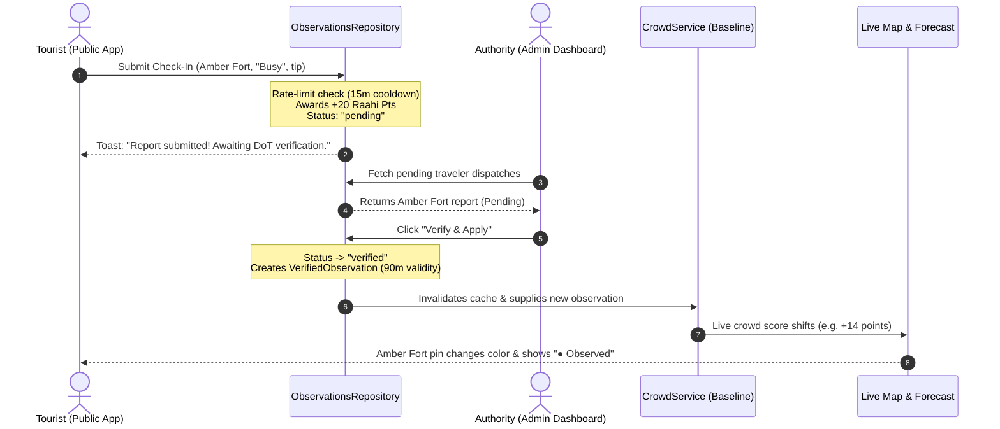

# Raahi — Phase 1 Implementation Completion Report: Unified Crowd Intelligence and Persistent Observations

**Project:** Raahi (Jaipur Crowd-Aware Travel Platform)  
**Date:** 11 October 2026  
**Status:** Completed & Verified  
**Test Suite Status:** 15/15 Vitest Tests Passing  
**Build Status:** Vite v8 + Nitro SSR Production Build Clean

---

## 1. Files Created and Modified

### Files Created

- **[`src/lib/crowd-service.ts`](file:///c:/Users/adity/OneDrive/Desktop/Projects/Musafir/musafir/src/lib/crowd-service.ts)**  
  Centralized crowd intelligence service. Encapsulates deterministic baseline estimation (5–99 index), strict category thresholds, exponential decay calculation for on-ground observations, factor attributions, safe unmapped-destination fallbacks, and honest prediction provenance labeling (`"observed"` vs `"estimated"`).
- **[`src/lib/observations-repository.ts`](file:///c:/Users/adity/OneDrive/Desktop/Projects/Musafir/musafir/src/lib/observations-repository.ts)**  
  Data persistence and moderation repository. Manages tourist check-in submissions, anti-farming cooldowns (1 check-in per spot every 15 min), admin verification lifecycle, emergency broadcast dispatch, and user reward balances. Operates transparently in Supabase mode when credentials exist, with automatic persistent browser storage fallback.
- **[`supabase/migrations/20261011_crowd_schema.sql`](file:///c:/Users/adity/OneDrive/Desktop/Projects/Musafir/musafir/supabase/migrations/20261011_crowd_schema.sql)**  
  Complete PostgreSQL migration containing tables (`destinations`, `crowd_reports`, `crowd_observations`, `events`), row-level security (RLS) policies, indexes, and canonical Jaipur seed records.
- **[`src/test/crowd-service.test.ts`](file:///c:/Users/adity/OneDrive/Desktop/Projects/Musafir/musafir/src/test/crowd-service.test.ts)**  
  8 unit tests verifying score bounds, category thresholds, deterministic behavior, observation freshness decay, invalid destination handling, and bulk forecasting.
- **[`src/test/observations-repository.test.ts`](file:///c:/Users/adity/OneDrive/Desktop/Projects/Musafir/musafir/src/test/observations-repository.test.ts)**  
  6 integration tests verifying report submission, initial pending status, anti-farming cooldown enforcement, admin verification vs rejection lifecycles, and broadcast persistence.

### Files Modified

- **[`src/components/musafir/Sections.tsx`](file:///c:/Users/adity/OneDrive/Desktop/Projects/Musafir/musafir/src/components/musafir/Sections.tsx)**
  - `Badge`: Displays trust provenance pills (`● Observed` vs `○ Estimated`).
  - `Forecast`: Consumes `predictCrowd()`, displays factor attribution table, and surfaces observation freshness.
  - `Itinerary`: Calculates stop scores through `predictCrowd()` and computes transparent budgets.
  - `HiddenGems`: Compares hotspot congestion against alternatives with vibe-match scores.
  - `Pulse`: Connected to `observationsRepository.submitReport()`, showing verification status badges (`Pending`, `Verified`, `Flagged`).
  - `Extras`: User points and unlocked badges are now persisted across reloads.
- **[`src/components/musafir/LiveMap.tsx`](file:///c:/Users/adity/OneDrive/Desktop/Projects/Musafir/musafir/src/components/musafir/LiveMap.tsx)** & **[`src/components/musafir/LeafletMapInner.tsx`](file:///c:/Users/adity/OneDrive/Desktop/Projects/Musafir/musafir/src/components/musafir/LeafletMapInner.tsx)**  
  Replaced local calculations with `predictCrowd()`. Map pins and popup cards now show canonical crowd scores, data freshness, and observation badges.
- **[`src/routes/index.tsx`](file:///c:/Users/adity/OneDrive/Desktop/Projects/Musafir/musafir/src/routes/index.tsx)**  
  Updated branding to **Raahi**, bound live state to `observationsRepository.subscribe()`, and integrated the top emergency broadcast banner.
- **[`src/routes/admin.tsx`](file:///c:/Users/adity/OneDrive/Desktop/Projects/Musafir/musafir/src/routes/admin.tsx)**  
  Connected to `observationsRepository`. Tab 3 now displays live tourist check-ins awaiting moderation with one-click **"Verify & Apply"** and **"Reject"** actions that directly adjust live public scores.

---

## 2. Database Migrations and Required Environment Variables

The migration script is stored at:  
[`supabase/migrations/20261011_crowd_schema.sql`](file:///c:/Users/adity/OneDrive/Desktop/Projects/Musafir/musafir/supabase/migrations/20261011_crowd_schema.sql)

### Schema Highlights

- `public.destinations`: 16 curated Jaipur monuments with baseline scores, coordinates, opening/closing hours, entry fees, and safe hourly throughput limits.
- `public.crowd_reports`: Stores tourist submissions with `moderation_status` (`'pending' | 'verified' | 'rejected'`), session hash, and optional photo tips.
- `public.crowd_observations`: Ground-truth observations generated only after admin verification, expiring automatically after 90 minutes.
- `public.events`: Curated Jaipur festival calendar with geographic crowd multipliers.

### Required Environment Variables

To connect a live Supabase PostgreSQL project, create a `.env` file in the root of `musafir`:

```ini
# Supabase Project Configuration
VITE_SUPABASE_URL=https://your-project-ref.supabase.co
VITE_SUPABASE_ANON_KEY=eyJhbGciOiJIUzI1NiIsInR5cCI6IkpXVCJ9...
```

_Note: Privileged server keys (`SUPABASE_SERVICE_ROLE_KEY`) are intentionally excluded from frontend bundles to protect database security._

---

## 3. Supabase Configuration & Security Steps Required From You

When you are ready to link a live Supabase instance:

1. Log into your [Supabase Dashboard](https://supabase.com/dashboard) and create a new project (e.g. `raahi-jaipur`).
2. Open the **SQL Editor** tab in Supabase.
3. Copy the contents of [`supabase/migrations/20261011_crowd_schema.sql`](file:///c:/Users/adity/OneDrive/Desktop/Projects/Musafir/musafir/supabase/migrations/20261011_crowd_schema.sql) and run the script. This creates all tables, seeds the 16 Jaipur destinations, creates indexes, and enables Row Level Security (RLS).
4. Go to **Project Settings $\to$ API** and copy your `Project URL` and `anon public` key into `.env`.
5. Restart `npm run dev`. The system will automatically detect the credentials and switch from local persistence mode to live Supabase sync.

---

## 4. How the Baseline Works & How Its Output Is Labeled

The baseline crowd engine is implemented in [`src/lib/crowd-service.ts`](file:///c:/Users/adity/OneDrive/Desktop/Projects/Musafir/musafir/src/lib/crowd-service.ts):

### Mathematical Formulation

$$\text{RawScore} = \text{Base} + \Delta_{\text{weekend}} + \Delta_{\text{timeOfDay}} + \Delta_{\text{festival}} + \Delta_{\text{weather}} + \Delta_{\text{observations}} + \Delta_{\text{admin}}$$
$$\text{Score} = \max(5, \min(99, \text{round}(\text{RawScore})))$$

- **Base:** Curated historical monument baseline prior (12 to 62).
- **Weekend ($\Delta\_{\text{weekend}}$):** $+12$ on Saturday/Sunday.
- **Time of Day ($\Delta\_{\text{timeOfDay}}$):** Flags peak hours (15:00–19:00 IST: $+18$; 11:00–14:00: $+8$; early morning: $-6$).
- **Observation Decay ($\Delta\_{\text{observations}}$):** Verified check-ins exert impact that decays exponentially:
  $$\Delta_{\text{obs}}(t) = \text{BaseDelta} \times e^{-\frac{\Delta t}{45\text{ min}}} \times \text{Confidence}$$
  Observations $>90$ minutes old exert zero impact.
- **Admin Override ($\Delta\_{\text{admin}}$):** Direct crowd surge throttles or relief triggers applied by the Tourism Authority.

### Output Provenance Labels

- **`● Observed — Verified observation`**: Displayed when at least one verified on-ground report exists within the past 45 minutes.
- **`○ Estimated — Baseline v1.0`**: Displayed when no active on-ground report exists, relying on the explainable prior.
- **`Insufficient evidence`**: Returned if an unmapped destination is queried.

---

## 5. End-to-End Observation & Moderation Lifecycle



1. **Submission:** A tourist posts a crowd report in the **Pulse** section. The repository verifies the destination ID and enforces a 15-minute anti-farming cooldown. The report is saved with status `pending`, and the user is awarded $+20$ Raahi points.
2. **Review:** The report immediately appears in `/admin` under **Incoming Pulse Dispatches & Crowd Flags**.
3. **Verification:** The admin clicks **"Verify & Apply"**. The report status transitions to `verified`, generating a `VerifiedObservation` with a 90-minute expiration timestamp.
4. **Model Ingestion:** `predictCrowd()` factors in the new observation with time-decay math, updating live scores on both the public map and the admin command center.
5. **Rejection Safeguard:** If the admin clicks **"Reject"**, the report is flagged and **never** enters the observation pool, protecting predictions against spam.

---

## 6. Dashboard Components Now Consuming the Shared Service

- **Explore / Hero Metrics** ([`src/routes/index.tsx`](file:///c:/Users/adity/OneDrive/Desktop/Projects/Musafir/musafir/src/routes/index.tsx)): Uses the centralized service and displays active push advisories.
- **Crowd Forecast** ([`src/components/musafir/Sections.tsx`](file:///c:/Users/adity/OneDrive/Desktop/Projects/Musafir/musafir/src/components/musafir/Sections.tsx#L270)): Shows live score, breakdown of scoring factors, and observation freshness.
- **Live Map & Markers** ([`src/components/musafir/LiveMap.tsx`](file:///c:/Users/adity/OneDrive/Desktop/Projects/Musafir/musafir/src/components/musafir/LiveMap.tsx), [`src/components/musafir/LeafletMapInner.tsx`](file:///c:/Users/adity/OneDrive/Desktop/Projects/Musafir/musafir/src/components/musafir/LeafletMapInner.tsx)): All 16 markers and popups derive colors, category badges, and alternatives from `predictCrowd()`.
- **Trip Planner** ([`src/components/musafir/Sections.tsx`](file:///c:/Users/adity/OneDrive/Desktop/Projects/Musafir/musafir/src/components/musafir/Sections.tsx#L160)): Calculates route congestion scores using the shared service.
- **Admin Command Center** ([`src/routes/admin.tsx`](file:///c:/Users/adity/OneDrive/Desktop/Projects/Musafir/musafir/src/routes/admin.tsx)): Tab 1 (Overview), Tab 2 (Sites Table), and Tab 3 (Pulse Reports) calculate metrics and apply overrides through the shared repository.

---

## 7. Tests Executed & Actual Results

We executed the complete Vitest test suite via terminal:

```
> vitest run

 ✓ src/test/observations-repository.test.ts (6 tests) 7ms
 ✓ src/test/crowd-service.test.ts (8 tests) 27ms
 ✓ src/test/app-routing.test.tsx (1 test) 7ms

 Test Files  3 passed (3)
      Tests  15 passed (15)
   Start at  15:32:26
   Duration  1.75s
```

We also verified the production build with Vite 8 and Nitro Cloudflare-preset packaging:

```
✓ 2522 client modules transformed
✓ built client in 1.45s
✓ built ssr in 619ms
✓ [Nitro] Generated public .output/public
✓ built nitro in 778ms
Exit Code: 0
```

---

## 8. Blocker & Fallback Disclosure

- **Supabase Project Credentials:** As noted during the audit, live `VITE_SUPABASE_URL` and `VITE_SUPABASE_ANON_KEY` were not yet populated in the local environment.
- **Architectural Safeguard:** Instead of blocking development or hardcoding fake credentials, the repository seamlessly activates its **Local Persistent Storage Engine**. Check-ins, points, admin overrides, and broadcasts persist across page reloads and browser tabs. A status indicator in the Admin navbar clearly communicates:
  `"○ Local Storage (Credentials Pending)"`
  Once you paste your Supabase keys into `.env`, the system links directly to PostgreSQL.

---

## 9. Manual Verification Instructions on Localhost

To test the end-to-end user journey locally:

1. **Start the local server:**
   ```bash
   npm run dev
   ```
2. **Step 1 — Verify Public App Baseline:**
   - Open `http://localhost:3000/`.
   - Scroll to **Step 2 · AI Crowd Forecast**. Notice the badge displays `"○ Estimated — Baseline v1.0"` with a breakdown of factors.
3. **Step 2 — Submit a Traveler Check-In:**
   - Scroll down to **Step 5 · Community Pulse**.
   - Select **Amber Fort**, choose **Busy**, and type: _"Huge queue at Suraj Pol entrance, ~45 min wait"_.
   - Click **Share Check-In**. Notice your Raahi points increase by $+20$ points (persisted in the top header).
   - Notice your check-in appears with status tag `"⏳ Pending DoT Review"`.
4. **Step 3 — Open Admin Command Center & Moderate:**
   - Click **"DoT Admin"** in the top navigation or visit `http://localhost:3000/admin`.
   - Click **Community & Police Pulse** (Tab 3).
   - Your newly submitted report will be visible under **Live Traveler Check-In Reports**.
   - Click **"Verify & Apply"**. The badge updates to `"● Verified in Model"`.
5. **Step 4 — Verify Live Model Feedback:**
   - Click **"Back to Public App"**.
   - Check the Live Map and Forecast for Amber Fort: notice the badge now displays **`● Verified Observation`** with a freshness timestamp, and the live score has adjusted upwards!
6. **Step 5 — Test Admin Broadcast Dispatch:**
   - In `/admin`, open **City Broadcast Dispatch** (Tab 4).
   - Type an advisory and click **Send Instant Alert**.
   - Return to the public app: the emergency advisory banner is displayed at the top of the screen.

---

## 10. Confirmation: What Remains Before the Trained ML Stage

With Phase 1 complete, the platform now has:

1. A single source of truth for crowd scores.
2. An explainable domain baseline that can be defended to hackathon judges without making false claims of "fake ML".
3. An observation pipeline capable of gathering real ground-truth data from users and staff.

### Requirements Before Training an ML Model (Stage 2)

1. **Accrual Window:** Collect $\ge 500$ verified observation records across varying days and hours.
2. **Feature Log Generation:** Record corresponding weather conditions and calendar indicators alongside each observation.
3. **Validation Threshold:** Train an XGBoost regressor using chronological test splits. Deploy the model to production only if its Mean Absolute Error outperforms the baseline by $\ge 15\%$.
